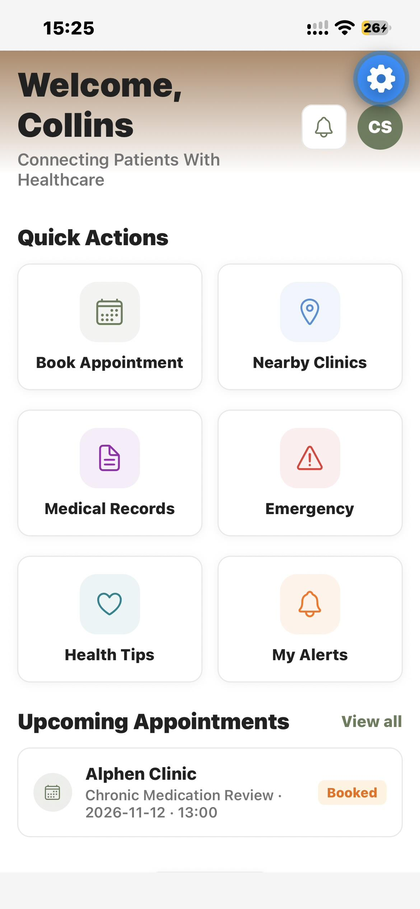
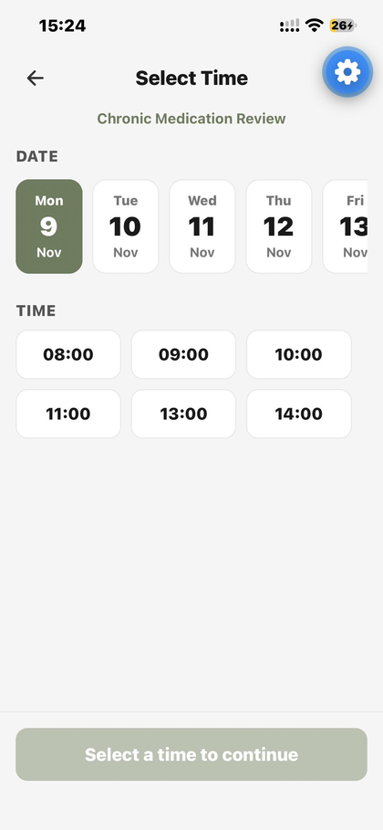
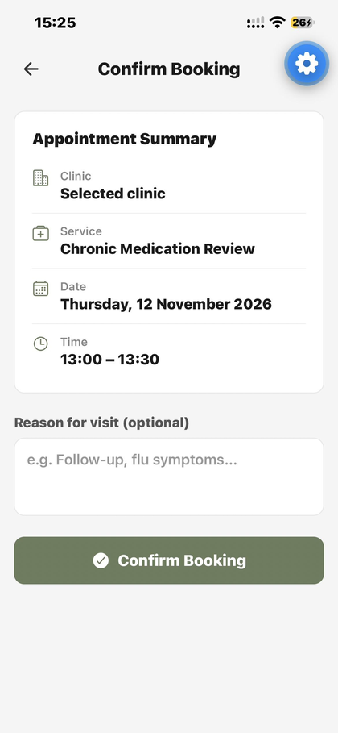
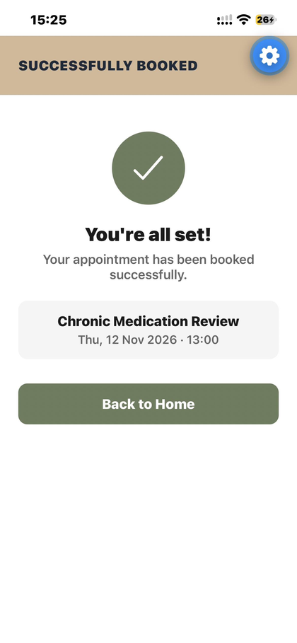
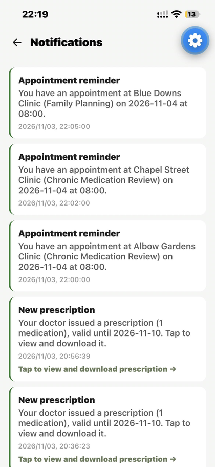
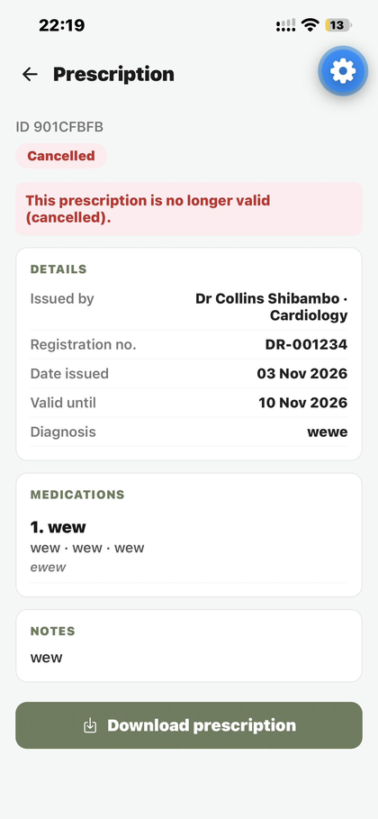
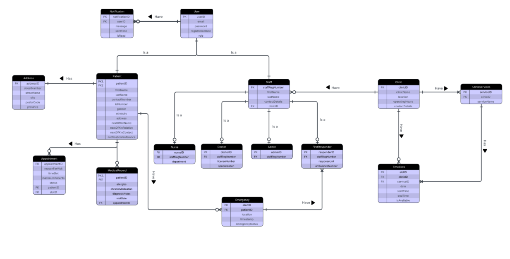
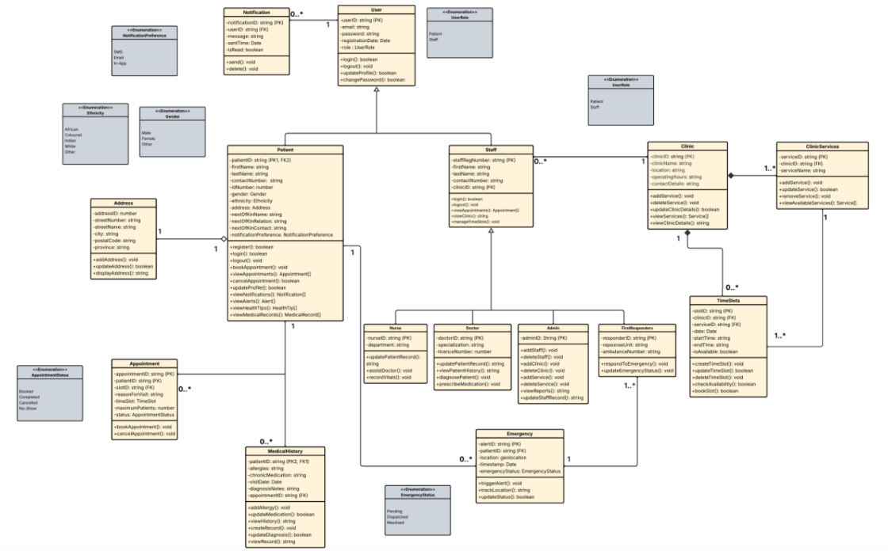

# ClinicConnect

**ClinicConnect** is a clinic appointment and patient-management system designed to help patients and healthcare workers manage clinic visits more efficiently. The system aims to reduce long queues, improve appointment scheduling, and make patient information easier for authorized healthcare workers to access.

It is a mobile-first, cross-platform application built with **React Native (Expo)** and **Supabase**, supporting iOS, Android, and Web.

---

## 📚 Academic Context

This project was developed as a group assignment for the **Cape Peninsula University of Technology (CPUT)**.

- **Faculty:** Faculty of Informatics & Design
- **Course:** Diploma in Information & Communication Technology
- **Module:** Project - PRT362S
- **Supervisor:** Mr. Zukile Ndyalivana

**Members:**

|      |
| :--- |
| Athi Sintiya |
| Thinna Barbara Booi |
| Sabelo Ceza |
| Mologadi Mosadinyana Dikgale |
| Andile Pamela Masina |
| Ntsobokwane Collins Shibambo |

---

## ✨ Features

### Patient

- **Registration & Authentication:** Email/password sign-up with OTP verification, and password reset.
- **Appointment Booking:** Search clinics, view available time slots, and book appointments.
- **Medical Records:** View and download personal medical history, visit summaries, and active prescriptions as PDFs.
- **Referrals:** View specialist referral letters issued by doctors.
- **Nearby Clinics:** Locate clinics using geolocation and map views.
- **Emergency Alerts:** One-tap SOS to alert first responders with location data.
- **Notifications:** Receive push and in-app reminders for upcoming appointments.

### Doctor & Nurse

- **Schedules:** View daily scheduled patients and manage queues.
- **Clinical Notes:** Record consultation notes, diagnoses, and vitals.
- **Prescriptions:** Issue digital prescriptions to patients.
- **Referrals:** Create and track specialist referrals.

### Administrator

- **Clinic Management:** Add and update clinic details, operating hours, and services.
- **Staff Management:** Create staff accounts and assign roles.
- **Scheduling:** Configure and manage clinic appointment time slots.

### First Responder

- **Emergency Dashboard:** Receive real-time alerts for nearby emergencies.
- **Status Updates:** Update emergency alert statuses (e.g., dispatched, resolved).

---

## 🛠 Tech Stack

| Layer | Technology |
| :--- | :--- |
| **Frontend** | React Native 0.88 + Expo SDK 58 |
| **Language** | TypeScript v5.x |
| **Navigation** | React Navigation |
| **Backend / DB** | Supabase (Hosted PostgreSQL 15) |
| **Authentication** | Supabase Auth (JWT, Email/Password + OTP) |
| **Storage** | Supabase Storage (PDFs for records/prescriptions) |
| **Realtime** | Supabase Realtime (Postgres LISTEN/NOTIFY) |
| **Notifications** | Expo Notifications + Supabase Push Edge Functions |
| **Testing** | Expo GO |

---

## Screenshots

Patient home screen and the booking flow:






Notifications and a prescription:




---

## System Design

Entity relationship diagram:



Class diagram:



---

## Getting Started

### Requirements

* Node.js version 20 or newer. The automated checks run on Node 24.
* Git
* The Expo Go app on an Android or iOS phone
* Access to the Supabase project

### Installation

Contributors work from a fork of the team repository.

```
git clone https://github.com/<your-username>/ClinicConnect.git
cd ClinicConnect
git remote add upstream https://github.com/220212317/ClinicConnect.git
npm ci
```

Use `npm ci` and not `npm install`. It installs the exact versions listed in
`package-lock.json`. If the versions drift, the Expo health check fails in the automated
checks.

### Environment variables

Create a file named `.env` in the project root:

```
EXPO_PUBLIC_SUPABASE_URL=https://<project-ref>.supabase.co
EXPO_PUBLIC_SUPABASE_ANON_KEY=<publishable key>
```

`.env` is listed in `.gitignore` and must never be committed.

Only the publishable key belongs in this file. Anything with the `EXPO_PUBLIC_` prefix is
bundled into the app and can be read by anyone who has the build. The Supabase secret key
must never appear in the code, in a screenshot or in a chat message. If it is ever shared
by mistake, rotate it in the Supabase dashboard straight away.

---

## Running the App

Start the development server, then scan the QR code that appears in the terminal with the
Expo Go app.

```
npm start
```

The other scripts are:

* `npm run web` starts the app in a browser.
* `npm run android` builds and runs a native Android build.
* `npm run ios` builds and runs a native iOS build.
* `npm run seed` loads sample clinics into the database.

### Running on a phone

The phone and the computer must be able to reach each other over the network. Campus
networks and many guest networks block this, which is the usual reason for the error
"There was a problem running the requested app" or a request that times out.

There are three ways to connect.

**Same Wi-Fi network.** Connect the phone and the computer to the same network and run
`npm start`. If the network isolates its clients, use one of the other two options.

**Computer hotspot, phone joins the computer.**

1. On Windows, open Settings, then Network and Internet, then Mobile hotspot. Set the
   band to 2.4 GHz and turn the hotspot on.
2. Connect the phone to that hotspot.
3. Find the hotspot address on the computer by running `ipconfig`. It is usually
   192.168.137.1.
4. Tell Metro to use that address, otherwise it may advertise a different network adapter
   and the phone will not reach it.

```
export REACT_NATIVE_PACKAGER_HOSTNAME=192.168.137.1
npx expo start -c
```

On PowerShell the first line is:

```
$env:REACT_NATIVE_PACKAGER_HOSTNAME = "192.168.137.1"
```

5. Check that the terminal prints `exp://192.168.137.1:8081`, then scan the QR code.

**Phone hotspot, computer joins the phone.** Turn on the personal hotspot on the phone,
connect the computer to it, then run `npx expo start -c`. This uses mobile data, so keep
the session short.

### If the phone still cannot connect

* The request times out. Windows Firewall is usually blocking Node. Allow Node.js on
  private networks, or add an inbound rule for TCP port 8081.
* Metro prints the wrong address. The computer has more than one network adapter. Set
  `REACT_NATIVE_PACKAGER_HOSTNAME` as shown above.
* Expo Go says the project is incompatible. The installed Expo Go does not match SDK 58.
  Update Expo Go or install the version that matches.
* Expo Go refuses to open the project and mentions an account. The phone and the command
  line tool are signed in to different Expo accounts. Run `npx expo whoami`, then
  `npx expo login` with the same account as the phone. You can also open Expo Go, choose
  Enter URL manually, and type `exp://<address>:8081`.
* The browser login crashes the command line tool on Windows. Create an access token at
  https://expo.dev/settings/access-tokens and set `EXPO_TOKEN` before starting the server.
* The app behaves strangely after pulling new changes. Clear the bundler cache by running
  `npx expo start -c`.

### Running in a browser

`npm run web` is useful for a quick look at a screen, but it is not the same as the real
app. Prescription download only opens the browser print dialog instead of saving a PDF,
and native dialogs, push notifications and some gestures behave differently. Anything
that matters should be tested on a real device.


## Database

Supabase hosts the Postgres database, authentication and file storage. Row level security
is switched on, so the rows a query returns depend on the role of the signed in user.

The main tables are users, patients, staff, clinics, services, time_slots, appointments,
medical_records, prescriptions, notifications and emergency alerts.

Migrations are kept in `supabase/migrations` and are applied by hand in the Supabase SQL
editor, in filename order.

---

## Automated Checks

The workflow in `.github/workflows/ci.yml` runs on every pull request and on every push
to main. It does the following:

1. Installs the dependencies with `npm ci`
2. Runs the TypeScript type check with `npx tsc --noEmit`
3. Runs the linter if one is configured
4. Runs the tests if any are present
5. Runs the Expo health check with `npx expo-doctor`

Run the type check and the Expo health check on your own machine before pushing. A
failure here blocks the pull request.

The project does not have a test script yet, so step 4 currently runs nothing.

---

## Contributing

Bring your fork up to date with the team repository before starting new work.

```
git checkout main
git fetch upstream
git merge --ff-only upstream/main
git push origin main
```

Create a branch for the work.

Then:

1. Keep the changes inside the files your task needs. If a shared file has to change,
   make the smallest change that works and tell the person who owns that file.
2. Run `npx tsc --noEmit` and `npx expo-doctor` before pushing.
3. Open a pull request against `220212317:main` and link the issue it closes.
4. The technical lead reviews and merges. Do not merge your own pull request.

Resolve merge conflicts on your own machine and run the type check before pushing.

---


